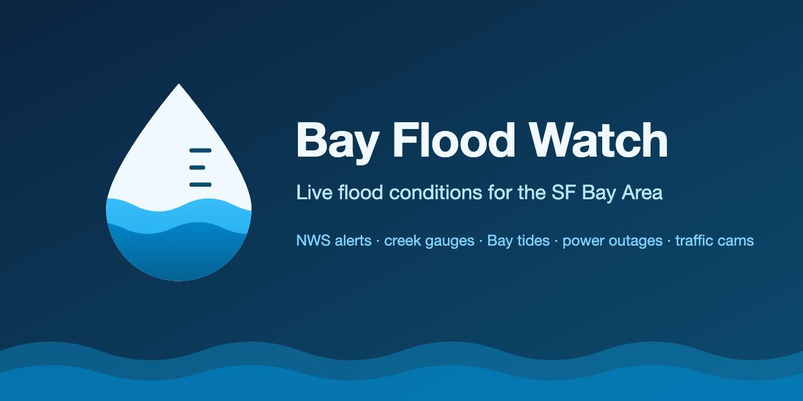

<p align="center">
  
</p>

# Bay Flood Watch

Live flood awareness for the San Francisco Bay Area: what's flooding now, and which way things are heading over the next 48 hours.

**→ [bayflood.watch](https://bayflood.watch)** (installable on iPhone and Android: Share → Add to Home Screen)

[](https://github.com/mcsplat/bay-flood/actions/workflows/ci.yml)
[](LICENSE)

> **Not an official warning service.** Bay Flood Watch combines public data to make it easier to see what's happening. It can be wrong, late, or incomplete. Follow instructions from local officials and call 911 in an emergency.

## Features

- **NWS alerts** for flood, flash flood, coastal flood, and high surf, drawn as areas on the map
- **Creek and river gauges** (330+), colored by flood category, with a hover meter comparing the current level to normal and flood stage, 2-hour trends, and official river forecasts
- **Bay tides** at five stations, with current storm surge and surge-adjusted projections for upcoming high tides
- **48-hour outlook**: a "getting worse / holding steady / improving" call with plain-language reasons, a rain timeline, and key moments (rain peaks, river crests, risky high tides, rain overlapping a high tide)
- **Power outages** from PG&E via Cal OES, with outage areas and restore estimates
- **Traffic cameras** (~800 Caltrans cameras) with recent-frame playback and live video, plus "nearby cameras" for each gauge
- **Installable and offline-tolerant**: keeps showing the last data it received when the connection drops

## Data sources

All sources are public and keyless.

| Layer | Source | Refresh |
|---|---|---|
| Flood, coastal, and surf alerts | National Weather Service, `api.weather.gov/alerts` (10 Bay Area counties) | 2 min |
| Bay water levels and flood thresholds | NOAA CO-OPS Tides & Currents (SF, Richmond, Alameda, Redwood City, Port Chicago) | 6 min |
| Creek and river gauges, river forecasts | NOAA National Water Prediction Service, `api.water.noaa.gov/nwps/v1` (mostly USGS gauges) | 5 min |
| Rain forecast (8 points, hourly) | NWS gridded forecast, `api.weather.gov/gridpoints` | 15 min |
| Power outages | Cal OES `Power_Outages_(View)` ArcGIS service, mirrored from PG&E | 5 min (source ~15 min) |
| Traffic cameras | Caltrans CWWP2 CCTV feeds (Districts 4 and 5) | list hourly; images every few minutes |
| Basemap | © OpenStreetMap contributors, © CARTO | — |

## How the estimates work

Everything here is deliberately simple and explainable, and labeled as an estimate in the app.

- **Tide projections:** surge = latest observed level minus the predicted tide. Each upcoming high tide is projected as predicted + current surge (a persistence estimate) and compared with the station's NWS/NOS flood thresholds, converted from station datum to MLLW.
- **Gauge trends:** least-squares slope over the last ~2.5 hours. Without an official forecast, a creek rising faster than 0.1 ft/hr gets a rough "could reach flood stage around…" time, capped at 12 hours.
- **Tidal gauges:** gauges near the Bay rise and fall with the tide. They're detected by correlating each gauge with itself one tidal day (~24.8 h) earlier, and are excluded from runoff trends and flood-stage estimates.
- **Outlook:** rain (next 6 h vs. last 6 h), creek trends, upcoming risky high tides, and active warnings each vote *worse*, *better*, or *neutral* and add a plain-language reason. The app won't call conditions "improving" while warnings are active or meaningful rain is still forecast.

## Running locally

Requires Node.js 20+ and npm. No API keys or `.env` file needed.

```bash
npm install   # also copies MapLibre's worker into public/maplibre/
npm run dev   # http://localhost:3000
```

Checks (the same ones CI runs):

```bash
npm run lint
npm run typecheck
npm run build
```

Built with Next.js 16 (App Router, Cache Components), React 19, TypeScript, Tailwind CSS 4, MapLibre GL, and hls.js. Deployed on Vercel.

## Contributing

Contributions are welcome, especially new data sources such as county creek-sensor networks and emergency shelters. See [CONTRIBUTING.md](CONTRIBUTING.md) for setup, project layout, and the pattern for adding a data layer. Please follow the [Code of Conduct](CODE_OF_CONDUCT.md), and report security issues privately as described in [SECURITY.md](SECURITY.md).

## Roadmap

1. Emergency resources: FEMA open shelters, curated sandbag stations, Genasys evacuation zones
2. County creek networks: Valley Water ALERT, OneShoreline (San Mateo), Marin, Sonoma, Alameda
3. More rain signals: MRMS radar, WPC excessive-rainfall outlook, CW3E atmospheric river scale
4. Community reports (photo, depth, confirmations), then 311, CHP, and 511 road closures
5. Push alerts for a saved location

## License

[MIT](LICENSE) © 2026 Matt Carter
